<picture>
  <source media="(prefers-color-scheme: light)" srcset="assets/profile/hero-light.svg">
  
</picture>

I design systems where hardware, phones and cloud services must agree on what's true, even when
networks drop, devices lie, or money is on the line.

Nairobi, Kenya (EAT, UTC+3) · Open to senior full-stack, IoT and platform roles ·
[koomekoome902@gmail.com](mailto:koomekoome902@gmail.com) · [DEV](https://dev.to/megalodon) ·
[LinkedIn](https://www.linkedin.com/in/cliffkoome/)

<picture>
  <source media="(prefers-color-scheme: light)" srcset="assets/profile/focus-light.svg">
  
</picture>

#### Selected work

<picture>
  <source media="(prefers-color-scheme: light)" srcset="assets/profile/projects-light.svg">
  
</picture>

[MatConnect](https://github.com/cliffkoome/MatConnect) · [InstaScreen](https://github.com/cliffkoome/InstaScreen) · [typeghast](https://github.com/cliffkoome/typeghast)

<b>Architecture worth a look</b>

| Project | What it is | Architecture worth a look | Stack |
|---|---|---|---|
| [**MatConnect**](https://github.com/cliffkoome/MatConnect) | Real-time matatu arrival display: GPS units in vehicles feed live ETAs and SMS alerts to passengers at stages. | Live GPS kept apart from the Postgres system of record; one leased ETA job that runs safely on a VM, on serverless cron or across several instances; trips, distance and SMS alerts stay correct through GPS dropouts, Maps outages and overlapping runs. [Design decisions →](https://github.com/cliffkoome/MatConnect/tree/main/docs/adr) | TypeScript, Next.js, Neon Postgres, Neon Auth, Prisma, Firebase RTDB, Google Maps, Africa's Talking |
| [**InstaScreen**](https://github.com/cliffkoome/InstaScreen) | A cloud-synced photo frame on an ESP32: publish from a laptop and it appears on a wall-mounted TFT, with no server to run. | A versioned, checksummed wire format chunked through Firebase RTDB to fit ~320 KB of SRAM; the device never draws a half-downloaded image; concurrent uploads are kept consistent by ETag compare-and-set rather than a backend. [Design decisions →](https://github.com/cliffkoome/InstaScreen/tree/main/docs/adr) | C++ (ESP32, Arduino), PlatformIO, Python, Firebase RTDB |
| [**typeghast**](https://github.com/cliffkoome/typeghast) | A terminal typing game played while a coding agent works. Ghosts multiply as the agent's context window fills. | Tails agent session logs in real time, a local open-weight model (Gemma 4 via Ollama) turns them into text to type; nothing leaves the machine. [Write-up on DEV →](https://dev.to/megalodon/typeghast-a-typing-game-haunted-by-your-coding-agents-context-window-5hkn) | Go, Bubble Tea, Ollama |

#### More work

| Project | What it shows | Stack |
|---|---|---|
| [**Haki Afya**](https://github.com/cliffkoome/haki-afya) | Checks a hospital bill against SHA tariffs in about 30 seconds. The model only reads the bill; plain code compares every line with the published tariff table and blocks invented figures. | Python, TypeScript, Gemma 4 |
| [**ChamaConnect security fixes**](https://github.com/cliffkoome/chamaconnect-bug-patch) | Found 15 vulnerabilities (6 critical) in a live savings-group platform with Burp Suite during an authorised hackathon: account takeover through a leaked reset OTP, IDOR, mass assignment. Then wrote and tested the fixes. | Next.js, MongoDB, Burp Suite |
| [**local-llm-speedtune**](https://github.com/cliffkoome/local-llm-speedtune) | Agent skill that picks the fastest local LLM engine and flags by measuring them. On an 8 GB RX 6600 XT at 49K tokens: prompt reading 3.1× faster, generation 32% faster. | Python, llama.cpp, Ollama |
| [**ds-loadbalancer**](https://github.com/cliffkoome/ds-loadbalancer) | Load balancer over a pool of Docker replicas: consistent hashing, health checks, and replacement of failed nodes. | Python, Flask, Docker |
| [**Hack Mavericks**](https://github.com/cliffkoome/hack-mavericks-mtah2027) | Ball-possession model from football tracking data: a 3-state Viterbi decoder. Rebuilds the submission byte for byte. | Python, pandas, scikit-learn |
| [**Zephyr**](https://github.com/cliffkoome/zephyr) | Offline AI coding tutor for 8 GB, CPU-only laptops: a 3B code model, RAG over a textbook, sandboxed code runs, Swahili support. | Python, FastAPI, ChromaDB |
| [**Echo Reach**](https://github.com/cliffkoome/echo-reach) | Climate alerts by phone call to feature phones, in local languages. | Node.js, Africa's Talking, Gemini |

#### Awards

- **Winner, Safaricom internal hackathon** (Oct 2026): AgenticZuri, a voice companion that lets blind, low-vision and older customers use the M-PESA app. Payment rules are enforced in code, not in a prompt. [Demo video](https://drive.google.com/file/d/17lo98Spfhplvs5aFz4E-eqEkGEWKm5t8/view)
- **Runner-up and Best Hardware Project, Build54 Build Zero** (May 2026): Halo, an ESP32 wearable panic button paired with a React Native app over Bluetooth LE. [Project page](https://devpost.com/software/halo-safety)
- **2nd place, ChamaConnect security hackathon** (Apr 2026). [Result](https://lnkd.in/p/dxeMpzEG) · [Fixes](https://github.com/cliffkoome/chamaconnect-bug-patch)

#### Experience

- **Freelance software developer** (2025 to now). Built and run the [Kyeni Girls High School portal](https://kyenigirls.sc.ke): public site, student resources and a staff admin panel used by over 30 staff, on Node.js/Express and MariaDB with role-based access, an API test suite and GitHub Actions CI, hosted on an Ubuntu VPS I run (Nginx, SSL, backups with a tested restore). Built the [clinic management system](https://github.com/Winstone-Were/ngothi-medical-system) that Ngothi Medical Clinic uses in production.
- **Embedded systems developer, @iLabAfrica, Strathmore University** (2023 to 2024). ESP32 and Arduino firmware in C/C++ for IoT research prototypes, and the gateways that carry device data to web backends.
- **ICT intern, Kenya National Police DT SACCO** (2025). Network access control with Cisco ISE, VLANs and vulnerability scanning.

#### Skills

- **Languages:** TypeScript, Python, C/C++, Go, Kotlin, Dart, SQL, PHP
- **Backend and web:** Node.js/Express, Next.js, React, FastAPI, Flask; REST APIs, auth and role-based access; Prisma, Drizzle, Sequelize
- **Mobile:** Flutter, React Native and Expo, Android (Kotlin, Jetpack Compose)
- **Embedded and IoT:** ESP32 and Arduino firmware, PlatformIO, Bluetooth LE GATT, TLS on constrained devices, device-to-cloud sync, GPS telemetry
- **Data and AI:** PostgreSQL, MariaDB/MySQL, MongoDB, Firebase; pandas, scikit-learn; RAG, local models (llama.cpp, Ollama), Gemini and Gemma
- **Delivery and operations:** GitHub Actions CI/CD, Docker; Vitest, pytest, Unity, Supertest, Playwright; Ubuntu, Nginx, PM2, Neon, Vercel
- **Security:** web and API testing with Burp Suite; fixing account takeover, IDOR, mass assignment and session issues

#### How I approach system design

- **Put the trust boundary in the right place.** Decide early what must run on the device, on the edge or in the cloud. In [Haki Afya](https://github.com/cliffkoome/haki-afya) the AI model only reads the bill and plain code decides every charge; typeghast keeps the agent's session on the machine.
- **Separate the hot path from the system of record.** Telemetry, events and user-facing state each get the store that fits them.
- **Design for failure first.** Flaky networks, offline devices and duplicate events are the normal case, not an edge case. InstaScreen verifies every image before it reaches the screen; MatConnect never counts a trip twice, even when GPS drops out or two runs overlap.
- **Write the decision down.** I record trade-offs as ADRs, as in [MatConnect](https://github.com/cliffkoome/MatConnect/tree/main/docs/adr) and [InstaScreen](https://github.com/cliffkoome/InstaScreen/tree/main/docs/adr), and MatConnect's README has a [scaling plan](https://github.com/cliffkoome/MatConnect#scaling).

#### Stack and activity

<picture>
  <source media="(prefers-color-scheme: light)" srcset="assets/profile/stack-light.svg">
  
</picture>

<picture>
  <source media="(prefers-color-scheme: light)" srcset="assets/profile/activity-light.svg">
  
</picture>

#### Now

- Writing about what I build on [DEV](https://dev.to/megalodon).
