<picture>
  <source media="(prefers-color-scheme: light)" srcset="assets/profile/hero-light.svg">
  
</picture>

I design systems where hardware, phones and cloud services must agree on what's true, even when
networks drop, devices lie, or money is on the line.

[koomekoome902@gmail.com](mailto:koomekoome902@gmail.com) ·
[LinkedIn](https://www.linkedin.com/in/cliffkoome/) · [DEV](https://dev.to/megalodon)

<picture>
  <source media="(prefers-color-scheme: light)" srcset="assets/profile/focus-light.svg">
  
</picture>

<picture>
  <source media="(prefers-color-scheme: light)" srcset="assets/profile/projects-light.svg">
  
</picture>

[MatConnect](https://github.com/cliffkoome/MatConnect) · [InstaScreen](https://github.com/cliffkoome/InstaScreen) · [typeghast](https://github.com/cliffkoome/typeghast)

<b>Architecture worth a look</b>

| Project | What it is | Architecture worth a look | Stack |
|---|---|---|---|
| [**MatConnect**](https://github.com/cliffkoome/MatConnect) | Real-time matatu arrival display: GPS units in vehicles feed live ETAs and SMS alerts to passengers at stages. | Live GPS kept apart from the Postgres system of record; one leased ETA job that runs safely on a VM, on serverless cron or across several instances; trips, distance and SMS alerts stay correct through GPS dropouts, Maps outages and overlapping runs. [Design decisions →](https://github.com/cliffkoome/MatConnect/tree/main/docs/adr) | TypeScript, Next.js, Neon Postgres, Neon Auth, Prisma, Firebase RTDB, Google Maps, Africa's Talking |
| [**InstaScreen**](https://github.com/cliffkoome/InstaScreen) | A cloud-synced photo frame on an ESP32: publish from a laptop and it appears on a wall-mounted TFT, with no server to run. | A versioned, checksummed wire format chunked through Firebase RTDB to fit ~320 KB of SRAM; the device never draws a half-downloaded image; concurrent uploads are kept consistent by ETag compare-and-set rather than a backend. [Design decisions →](https://github.com/cliffkoome/InstaScreen/tree/main/docs/adr) | C++ (ESP32, Arduino), PlatformIO, Python, Firebase RTDB |
| [**typeghast**](https://github.com/cliffkoome/typeghast) | A terminal typing game played while a coding agent works. Ghosts multiply as the agent's context window fills. | Tails agent session logs in real time, a local open-weight model (Gemma 4 via Ollama) turns them into text to type; nothing leaves the machine. [Write-up on DEV →](https://dev.to/megalodon/typeghast-a-typing-game-haunted-by-your-coding-agents-context-window-5hkn) | Go, Bubble Tea, Ollama |

<picture>
  <source media="(prefers-color-scheme: light)" srcset="assets/profile/toolbox-light.svg">
  
</picture>

#### More I've built

- [**Haki Afya**](https://github.com/cliffkoome/haki-afya): checks a hospital bill against SHA tariffs in 30 seconds. AI reads, code decides.
- [**ChamaConnect fixes**](https://github.com/cliffkoome/chamaconnect-bug-patch): 15 vulnerabilities found and patched in a live savings-group app.
- [**local-llm-speedtune**](https://github.com/cliffkoome/local-llm-speedtune): local LLMs 3.1× faster, by measuring instead of guessing.
- [**ds-loadbalancer**](https://github.com/cliffkoome/ds-loadbalancer): consistent hashing over self-healing Docker replicas.
- [**Hack Mavericks**](https://github.com/cliffkoome/hack-mavericks-mtah2027): football ball-possession model, reproducible to the byte.
- [**Zephyr**](https://github.com/cliffkoome/zephyr): an offline AI coding tutor that runs on an 8 GB laptop.
- [**Echo Reach**](https://github.com/cliffkoome/echo-reach): climate alerts by phone call, in local languages.

#### Awards

- **Winner**, Safaricom internal hackathon 2026: AgenticZuri, a voice companion for M-PESA. [Demo](https://drive.google.com/file/d/17lo98Spfhplvs5aFz4E-eqEkGEWKm5t8/view)
- **Runner-up + Best Hardware**, Build54 Build Zero 2026: Halo, an ESP32 panic-button wearable. [Project](https://devpost.com/software/halo-safety)
- **2nd place**, ChamaConnect security hackathon 2026. [Result](https://lnkd.in/p/dxeMpzEG)

#### How I approach system design

- **Trust boundary first.** Decide what runs on the device, the edge or the cloud. In Haki Afya the model reads the bill; code decides every charge.
- **Keep the hot path apart from the record.** Telemetry, events and state each get the store that fits.
- **Failure is the normal case.** InstaScreen never shows a half-downloaded image; MatConnect never counts a trip twice.
- **Write it down.** ADRs in [MatConnect](https://github.com/cliffkoome/MatConnect/tree/main/docs/adr) and [InstaScreen](https://github.com/cliffkoome/InstaScreen/tree/main/docs/adr), plus a [scaling plan](https://github.com/cliffkoome/MatConnect#scaling).

<picture>
  <source media="(prefers-color-scheme: light)" srcset="assets/profile/activity-light.svg">
  
</picture>
