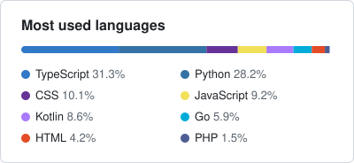

### Hi, I'm Clifford Karani

**Full-stack software engineer: IoT, embedded systems and systems architecture.**
I design systems where hardware, phones and cloud services must agree on what's true, even when
networks drop, devices lie, or money is on the line.

Nairobi, Kenya (EAT, UTC+3) · Open to senior full-stack, IoT and platform roles ·
[koomekoome902@gmail.com](mailto:koomekoome902@gmail.com) · [DEV](https://dev.to/megalodon) ·
[LinkedIn](https://www.linkedin.com/in/cliffkoome/)

---

#### Selected work

| Project | What it is | Architecture worth a look | Stack |
|---|---|---|---|
| [**MatConnect**](https://github.com/cliffkoome/MatConnect) | Real-time matatu arrival display: GPS units in vehicles feed live ETAs and SMS alerts to passengers at stages. | Live GPS kept apart from the Postgres system of record; one leased ETA job that runs safely on a VM, on serverless cron or across several instances; trips, distance and SMS alerts stay correct through GPS dropouts, Maps outages and overlapping runs. [Design decisions →](https://github.com/cliffkoome/MatConnect/tree/main/docs/adr) | TypeScript, Next.js, Neon Postgres, Neon Auth, Prisma, Firebase RTDB, Google Maps, Africa's Talking |
| [**InstaScreen**](https://github.com/cliffkoome/InstaScreen) | A cloud-synced photo frame on an ESP32: publish from a laptop and it appears on a wall-mounted TFT, with no server to run. | A versioned, checksummed wire format chunked through Firebase RTDB to fit ~320 KB of SRAM; the device never draws a half-downloaded image; concurrent uploads are kept consistent by ETag compare-and-set rather than a backend. [Design decisions →](https://github.com/cliffkoome/InstaScreen/tree/main/docs/adr) | C++ (ESP32, Arduino), PlatformIO, Python, Firebase RTDB |
| [**typeghast**](https://github.com/cliffkoome/typeghast) | A terminal typing game played while a coding agent works. Ghosts multiply as the agent's context window fills. | Tails agent session logs in real time, a local open-weight model (Gemma 4 via Ollama) turns them into text to type; nothing leaves the machine. [Write-up on DEV →](https://dev.to/megalodon/typeghast-a-typing-game-haunted-by-your-coding-agents-context-window-5hkn) | Go, Bubble Tea, Ollama |

#### How I approach system design

- **Put the trust boundary in the right place.** Decide early what must run on the device, on the edge or in the cloud. Zuri keeps payments on the phone; typeghast keeps the agent's session on the machine.
- **Separate the hot path from the system of record.** Telemetry, events and user-facing state each get the store that fits them.
- **Design for failure first.** Flaky networks, offline devices and duplicate events are the normal case, not an edge case. InstaScreen verifies every image before it reaches the screen; MatConnect never counts a trip twice, even when GPS drops out or two runs overlap.
- **Write the decision down.** I document the trade-offs I made and what I'd change at 10× scale, as in the ADRs for InstaScreen and MatConnect.

#### Now

- Writing about what I build on [DEV](https://dev.to/megalodon).

#### Activity

<picture>
  <source media="(prefers-color-scheme: dark)" srcset="https://streak-stats.demolab.com/?user=Cliffkoome&background=0d1117&border=30363d&stroke=30363d&ring=3178c6&fire=3178c6&currStreakNum=f0f6fc&sideNums=f0f6fc&currStreakLabel=f0f6fc&sideLabels=f0f6fc&dates=9198a1&border_radius=6">
  
</picture>
<picture>
  <source media="(prefers-color-scheme: dark)" srcset="assets/languages-dark.svg">
  
</picture>
